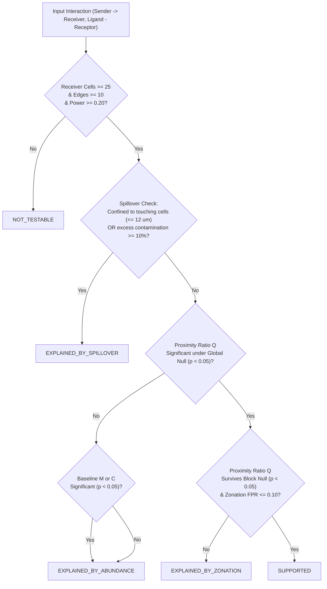

# ccc-audit: Spatial Cell-Cell Communication Audit Framework

`ccc-audit` is an installable, tested Python framework designed to audit spatial transcriptomics cell-cell communication (CCC) hypotheses. It determines whether apparent intercellular signaling signals are genuine juxtacrine/proximity effects or artefacts of:
1. **Cell-type Abundance**: Non-spatial baseline co-expression mirroring cellular frequencies.
2. **Regional Zonation**: Coarse spatial compartmentalisation (e.g., stroma vs tumour nests) that inflates naive spatial tests.
3. **Segmentation Spillover**: Optical and transcript bleeding from adjacent cells that mimics receptor upregulation.

---

## 1. What Problem It Solves
Current CCC tools frequently report hundreds of "significant" ligand-receptor interactions. However, extensive benchmarking reveals:
- Most edge-based scores simply mirror cell-type abundance products (compositional confounding).
- Spatially unconstrained (global) permutation tests reject almost anywhere cell types are regionally segregated.
- High-plex in situ platforms (CosMx, Xenium, MERSCOPE) suffer from imperfect optical segmentation: touching cells carry up to 20–30% excess transcripts from their neighbours.

`ccc-audit` decomposes interaction scores into:
- $C_{sr} = (\bar{L}_s + \bar{R}_r) / 2$ (Compositional score)
- $E_{sr} = \frac{1}{|E_{sr}|} \sum_{(i \to j) \in G} L_i R_j$ (Edge-restricted contact score)
- $M_{sr} = \bar{L}_s \cdot \bar{R}_r$ (Matched dyadic non-spatial baseline)
- $Q_{sr} = E_{sr} / M_{sr}$ (Proximity enrichment ratio)

It then subjects each lead to spatially constrained block nulls, empirical power calibration, segmentation spillover diagnostics, and grouped cross-validation.

---

## 2. Installation

Requires Python >= 3.10. Install from local source:

```bash
git clone <repo-url>
cd framework
pip install -e .
```

To install dev and modeling dependencies (XGBoost, PyTorch, Pytest):
```bash
pip install -e ".[models,dev]"
```

---

## 3. Input Contract
`ccc-audit` consumes standard single-cell spatial transcriptomics data formatted as an [`AnnData`](https://anndata.readthedocs.io/) object.

### Required `adata.obs` Columns
- `cell_type` (str / categorical): High-confidence cell type annotation.
- `patient_id` (str / categorical): Patient or biological donor identifier (unit of statistical independence).
- `section_id` (str / categorical): Tissue slide or section identifier.
- `x_um` (float): Centroid x coordinate in physical micrometres ($\mu\text{m}$).
- `y_um` (float): Centroid y coordinate in physical micrometres ($\mu\text{m}$).

### Optional Modalities
- `adata.layers["counts"]`: Raw transcript counts (used for Poisson simulation calibration).
- Negative control probe channels (e.g., `NegPrb*`) for optical background detection.
- Protein staining channels in `adata.obs` or `adata.obsm["protein"]`.

---

## 4. Quick Start: One Command
Run an end-to-end audit on your spatial dataset with a YAML configuration:

```bash
ccc-audit run config.yaml
```

### Example `config.yaml`
```yaml
title: "Tumour Microenvironment Audit"
output_dir: "results/audit_run"
seed: 42

data:
  path: "data/processed/mendeley_u5a_contract.h5ad"

graph:
  k: 6

interactions:
  - sender: "CAF"
    receiver: "CD8+ T"
    ligand: "CXCL12"
    receptor: "CXCR4"
  - sender: "CAF"
    receiver: "Macrophage"
    ligand: "COL1A1"
    receptor: "CD44"

nulls:
  n_perms: 500
  tile_size_um: 100.0

spillover:
  enabled: true
```

Deliverables produced:
- `claims_register.csv`: Formal register of audit claims and evidence status.
- `scores_global_null.csv` & `scores_block_null.csv`: Detailed C, E, M, Q scores and empirical p-values.
- `spillover_summary.csv`: Physical distance gradient and excess contamination rates.
- `figures/audit_summary_figure.png`: Scatter plot and verdict distribution.
- `AUDIT_REPORT.md`: Comprehensive markdown audit report.

---

## 5. How to Read Each Verdict

Every interaction receives exactly one of five categorical verdicts:

| Verdict | Meaning | Biological Interpretation |
|---|---|---|
| **`SUPPORTED`** | Passed all falsification controls. | Signal represents a genuine spatial proximity enrichment that persists under block nulls and outside optical spillover range. |
| **`EXPLAINED_BY_ABUNDANCE`** | Edge score matches dyadic baseline $M$. | Apparent interaction is driven by high cell-type frequency; ratio $Q \approx 1$ ($p \ge 0.05$). |
| **`EXPLAINED_BY_ZONATION`** | Significant globally, null locally. | Signal reflects macroscopic tissue compartmentalisation ($100-200\,\mu\text{m}$ nests) rather than direct contact. |
| **`EXPLAINED_BY_SPILLOVER`** | Signal restricted to touching cells. | Signal is an optical/segmentation artefact; touching cells absorb sender transcripts, but separated cells show zero effect. |
| **`NOT_TESTABLE`** | Below empirical detection floor. | Insufficient cells (< 25) or contact edges (< 10) to reliably detect biological effect sizes. |

---

## 6. Decision Flowchart



---

## 7. Methodological Limitations
1. **Expression, not protein or activity:** RNA counts do not guarantee protein translation or receptor activation.
2. **Unit of inference:** Associations are evaluated at the patient/tumour level; individual cells are clustered observations.
3. **Power floor:** Proximity ratio tests require at least 25–50 receiver cells per section to achieve 80% power at $1.5\times$ effect sizes.

---

## 8. Underlying Methods and Citations
The methods, null models, and baseline architectures integrated into `ccc-audit` build upon the following foundations:

- **Squidpy:**
  Palla, G., Spitzer, H., Klein, M. *et al.* "Squidpy: a scalable framework for spatial omics analysis." *Nat Methods* 19, 171–178 (2022).
  [https://github.com/scverse/squidpy](https://github.com/scverse/squidpy) | [DOI: 10.1038/s41592-021-01358-2](https://doi.org/10.1038/s41592-021-01358-2)
- **MISTy:**
  Tanevski, J., Flores, R.O.R., Gaboriau, D. *et al.* "Explainable multiview framework for dissecting spatial relationships from highly multiplexed data." *Genome Biology* 23, 97 (2022).
  [https://github.com/saezlab/mistyR](https://github.com/saezlab/mistyR) | [DOI: 10.1186/s13059-022-02663-5](https://doi.org/10.1186/s13059-022-02663-5)
- **NCEM:**
  Fischer, D.S., Schaar, A.C., Theis, F.J. "Modeling intercellular communication in tissues using spatial graphs of cells." *Nature Biotechnology* 41, 332–341 (2023).
  [https://github.com/theislab/ncem](https://github.com/theislab/ncem) | [DOI: 10.1038/s41587-022-01467-z](https://doi.org/10.1038/s41587-022-01467-z)
- **COMMOT:**
  Cang, Z., Zhao, Y., Almet, A.A. *et al.* "Screening cell-cell communication in spatial transcriptomics via collective optimal transport." *Nature Communications* 14, 589 (2023).
  [https://github.com/zcang/COMMOT](https://github.com/zcang/COMMOT) | [DOI: 10.1038/s41467-023-36038-x](https://doi.org/10.1038/s41467-023-36038-x)
- **SpatialDM:**
  Li, Z., Wang, T. *et al.* "SpatialDM for rapid identification of spatially co-expressed ligand–receptor and revealing cell–cell communication patterns." *Nature Communications* 14, 3995 (2023).
  [https://github.com/StatBiomed/SpatialDM](https://github.com/StatBiomed/SpatialDM) | [DOI: 10.1038/s41467-023-39608-w](https://doi.org/10.1038/s41467-023-39608-w)
